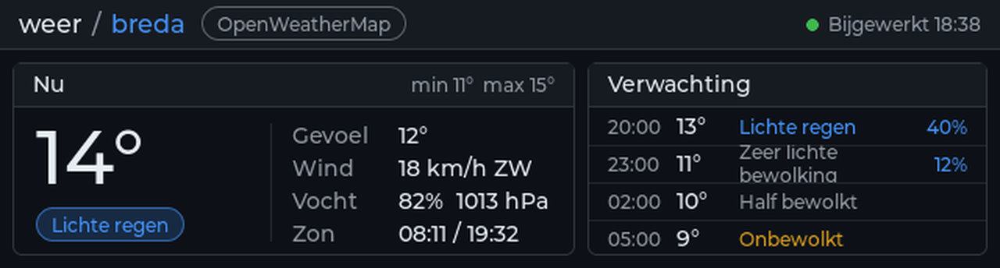

# Breda Weather — weather station for the Waveshare ESP32-S3-Touch-LCD-3.49 (V2)

Fetches the current weather and the forecast for Breda from OpenWeatherMap
every 10 minutes and shows it in landscape (640 × 172) in the style of GitHub.
Tap the screen to refresh right away.



> Only for **V2** of the board ("Rev1.1" printed on the PCB).
> V1 has different pins and does not work with this code.

The texts on the screen are in Dutch, for example `Nu` (now), `Verwachting`
(forecast) and `Bijgewerkt` (updated).

## What you need

- The Waveshare board (V2) and a **USB-C cable that carries data** (not just charging)
- A PC with Windows, macOS or Linux
- [VS Code](https://code.visualstudio.com/) with the **"ESP-IDF"** extension by Espressif
- **ESP-IDF v5.5.3** (installed through the extension, see below)
- A free OpenWeatherMap account and API key
- A 2.4 GHz Wi-Fi network

## 1. Once: install ESP-IDF

1. Install VS Code and open the Extensions view (Ctrl+Shift+X).
2. Search for **ESP-IDF** and install the extension by Espressif Systems.
3. The setup wizard starts by itself (or: Ctrl+Shift+P → "ESP-IDF: Configure ESP-IDF Extension").
4. Choose **Express**, select version **v5.5.3** and click Install. This takes a while
   (a download of several GB).
5. Windows: the USB driver is not needed; the ESP32-S3 has built-in USB.

## 2. Fill in the API key and Wi-Fi

Create an account at <https://home.openweathermap.org/users/sign_up> and copy
your key from <https://home.openweathermap.org/api_keys>.

Copy **`main/credentials.example.h`** to **`main/credentials.h`** and fill in:

```c
#define WIFI_SSID       "your-wifi-name"
#define WIFI_PASSWORD   "your-wifi-password"
#define OWM_API_KEY     "paste-your-api-key-here"
```

A new API key can take a few hours to become active.
Until then the screen shows a red dot with "HTTP 401".

## 3. Build and upload

1. Open the `esp32-bluedisplay-weather-app` folder in VS Code (File → Open Folder).
2. Connect the board via USB-C.
3. Choose in the blue status bar at the bottom:
   - **Target**: `esp32s3` (choose "ESP32-S3 chip (via builtin USB-JTAG)")
   - **Port**: the board's COM port / `/dev/ttyACM0` / `/dev/cu.usbmodem…`
   - **Flash method**: UART
4. Click the **flame icon** (Build, Flash and Monitor).

The first build takes a few minutes: LVGL and the display drivers are then
downloaded automatically to `managed_components/`. After that it is much faster.

Prefer the command line? Open an "ESP-IDF Terminal" (Ctrl+Shift+P) and type:

```
idf.py set-target esp32s3
idf.py build flash monitor
```

Stop the monitor with **Ctrl+]**.

**Upload not working?** Put the board into download mode manually: hold the
**BOOT** button (on the back), briefly press **RESET**, release BOOT and
try again. Press RESET once more after flashing.

## How the program works

```
app_main()                       main.c
 ├─ display_init()               display_port.c  display, touch, LVGL task
 ├─ battery_init()               battery.c       ADC for the battery voltage
 ├─ ui_create()                  ui.c            build the screen (+ battery timer, every 30 s)
 ├─ wifi_start()                 wifi.c          connect in the background
 └─ weather_task (own task)      main.c
      loop: wait for Wi-Fi → weather_fetch() → ui_update() → wait 10 min
                                 weather.c       HTTPS + parse JSON
```

Two tasks run at the same time: the **LVGL task** (draws the screen) and the
**weather task** (fetches the data). LVGL may only be used by one task at a
time, which is why every UI call from the weather task sits between
`display_lock()` and `display_unlock()`.

| File | What's in it | Change it? |
|---|---|---|
| `main/credentials.h` | Wi-Fi, API key, location, refresh time | **Yes** |
| `main/ui.c` | The screen: layout, colours, texts | To taste |
| `main/weather.c` | API call and JSON parsing | If you want more data |
| `main/battery.c` | Measuring the battery voltage and converting it to % | Rarely |
| `main/wifi.c` | Wi-Fi connection | No |
| `main/main.c` | Start-up and the weather task | No |
| `main/display_port.c` | Display/touch driver (from the Waveshare example) | No |
| `main/user_config.h` | Board pins (Waveshare V2) | No |
| `components/` | Waveshare helper code for I2C and backlight | No |
| `sdkconfig.defaults` | Settings (PSRAM, fonts, HTTPS) | Rarely |

## Customising

- **Light theme**: in `main/ui.c`, set `#define UI_DARK_THEME` to `0`.
- **Screen upside down**: in `main/display_port.h`, set the rotation to `LV_DISPLAY_ROTATION_270`.
- **Another city**: change `WEATHER_CITY`, `WEATHER_LAT` and `WEATHER_LON` in `credentials.h`.
- **Another font size**: only fonts enabled in `sdkconfig.defaults`
  (12, 14, 16, 20, 48) are available. If you add one, delete the
  `sdkconfig` file so the settings are read again.

## Battery indicator

To the right of the OpenWeatherMap label is the battery status: a symbol and a
percentage. The colour is green above 50 %, yellow down to 20 % and red below that.

- **Measurement**: the battery voltage goes through a voltage divider (÷3) to GPIO4
  (ADC1 channel 3). `battery.c` averages 8 readings and
  multiplies by 3. Settings at the top of `main/battery.c`:
  `BAT_DIVIDER`, `BAT_SAMPLES` and the attenuation (`ADC_ATTEN_DB_12`).
- **Percentage**: a table in `battery_percent()` converts the voltage into an
  estimated charge (4.2 V = 100 %, 3.3 V = 0 %). If your battery has a different
  curve, adjust that table.
- **Refresh**: every 30 seconds, through an LVGL timer in `ui_create()` in `main/ui.c`.
- If the measurement fails, the label stays empty.

## Troubleshooting

| On the screen / in the monitor | Cause |
|---|---|
| Black screen | Wrong hardware version (V1?), or the upload did not succeed |
| "Geen Wi-Fi: controleer credentials.h" (no Wi-Fi: check credentials.h) | Wrong SSID/password, or a 5 GHz network |
| "HTTP 401: API-key ongeldig..." (API key invalid) | Key copied incorrectly, or not active yet |
| "Geen verbinding met API" (no connection to the API) | Internet or DNS does not work through this network |
| Text is upside down | Set the rotation to 270 (see above) |

In the monitor (at the bottom of VS Code) you see log lines such as
`I (5123) wifi: Verbonden, IP-adres: 192.168.1.42` ("connected, IP address") that show exactly
where things go wrong.
